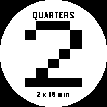

# PulseTime

A clock you can feel. PulseTime tells the local time through vibration on
Wear OS, Pebble, and Garmin.

A friend who is visually impaired asked me to build a way to feel the time.
That request became PulseTime: a clock with known-time lessons to help you
learn the rhythm, and large, high-contrast digits for anyone who can use them.

**License:** MIT · A small project for friends and anyone it helps.
See [source and artwork notices](NOTICES.md) for the bundled dependency and graphics.

Created by **Luke Steuber**. PulseTime is a standalone project with its own
packages and settings.

## Try PulseTime on Pebble

Install [**PulseTime Public Beta**](https://apps.repebble.com/1624684ac5dd46ac85eee2a6) from the Pebble app store.
Version **1.2.0** appears as **PulseTime** in the watch's app list. The first
launch opens **Learn pattern**. Press Down for the 3:32 hours lesson, Down again
for minutes, and Down once more for the whole answer. Select plays the current
example. Hold Select from the clock to return to learning and settings.

I welcome feedback and ideas at [luke@lukesteuber.com](mailto:luke@lukesteuber.com).
Tell me your watch model, what you expected, and what you felt.

During lessons and time checks, one huge black-and-white numeral follows each
vibration group. In the default pattern, **3 hours + 2 quarters means about
3:30**. The clock still shows the exact minute between answers.




Start with the [Pebble wearer guide](appstores/pebble/pulsetime/GUIDE.md) for
installation, side-button setup, and recovery. The optional **PulseTime Face**
package gives you double-tap playback from its clock face. Both packages support
rectangular and round screens, with large clock digits in bright or dark layouts.

Version 1.2.0 builds for all six supported Pebble targets. The app has installed
successfully on Time 2 and 2 SE; on-wrist readability and pattern recognition
checks are underway. See the [validation record](appstores/pebble/pulsetime/VALIDATION.md)
for the exact coverage, or the [sharing notes](appstores/pebble/pulsetime/SHARING.md)
for the package list and a short introduction you can send with it.

## Time systems

PulseTime includes six haptic time languages. Pebble offers seven menu choices
because Terse Quarter appears with and without exact-minute ticks:

- **Terse Quarter:** hours, quarters, and optional leftover-minute ticks
- **Five-Minute Ladder:** hours, five-minute steps, and leftover minutes
- **Decimal Place Rhythm:** hours, minute tens, and minute ones
- **Binary Clock:** four hour bits followed by six minute bits
- **Nearest-Quarter Offset:** a quarter-hour landmark plus before/after minutes
- **Morse Digits:** displayed digits as standard Morse numerals

Start with **Terse Quarter, Standard speed, approximate to the quarter**.
Exact-minute ticks, alternate languages, sound,
scheduled chimes, and gesture workers are opt-in. Existing installs keep every
saved choice. No system depends on amplitude alone.

## Android companion

The `:mobile` companion teaches every system on its own page. Each page includes
a pulse legend, worked examples, watch demonstrations, and a replayable test.
Separate pages explain playback speed, layered strength, and exact minutes.

When a compatible watch is reachable, the phone sends an immediate versioned
playback request through the Wear OS Data Layer. The watch validates the request,
generates the pattern locally, starts the vibration, and acknowledges playback.
Demonstrations never change saved watch settings and are never queued offline.

## Pulse Lab phone testing

The separate `:hapticlab` app runs the same six PulseTime encoders through the
phone's vibrator. It includes practice times, speed and strength controls,
exact-minute options, explanations, and untimed blind trials.

The signal library contains twelve fictional examples. They cover markets,
weather, messages, calendar reminders, transit, exercise pace, home events,
software status, and live games. Every example follows the same tactile phrase:
topic, payload, optional modifier, and optional action. Several examples also
compare a short headline with the full phrase.

The perception lab reports the phone's haptic capabilities, checks comfortable
strength, and compares direction, urgency, and field-boundary patterns. A
personal pattern builder lets testers arrange short pulses, long pulses,
strength levels, and pauses. Pulse Lab records answers, confidence, replays,
test context, and untimed total round duration for the current session.

The feedback page lets blind and sighted testers describe what they felt, what
they thought it meant, comfort, TalkBack, and navigation. Feedback leaves the
app only when the tester opens Android's share sheet and chooses a destination.
The app explains its testing limits, safety boundaries, and phrase grammar on
the **How Pulse Lab works** page.

Pulse Lab uses the independent package `com.lukesteuber.pulsetime.hapticlab`,
so it can be installed beside both PulseTime apps. It needs no watch, pairing,
network access, account, location, contacts, or notification permissions.

### Terse Quarter

1. **Hours** 1–12: 200 ms ON / 280 ms OFF
2. **700 ms** silence
3. **Quarters** 0–3: 320 ms ON / 280 ms OFF
4. Optional **exact minutes** after training: 80 ms ticks, separated by 120 ms, for the remainder inside the quarter

Example: **3:20** → 3 hour pulses, pause, 1 quarter pulse.

Base amplitude is 180/255 × your calibration scale.

## Requirements

- JDK 21 (toolchain) / project compiles with Java 17 bytecode  
- Android SDK with Wear OS (compileSdk 36, minSdk 30, targetSdk 35)  
- A physical watch for haptic QA. **Emulator vibration is not sufficient.**

Gradle must run with JDK 21, and the Android SDK must be available through
`ANDROID_HOME` or `sdk.dir` in the ignored `local.properties` file. JDK 26 is
not supported by this project's Kotlin/Gradle toolchain.

## Build

```sh
./gradlew :app:testDebugUnitTest
./gradlew :app:assembleDebug
./gradlew :shared:testDebugUnitTest :mobile:assembleDebug
./gradlew :hapticlab:testDebugUnitTest :hapticlab:lintDebug :hapticlab:assembleDebug
scripts/build-play-release.sh  # signed phone + Wear AABs for closed testing
```

Pulse Lab's published APK is release-signed with its own key and is never
debuggable. The key lives in the release toolkit's store, with its password in
the login Keychain, so the build runs through the toolkit:

```sh
~/workspace/android-release-toolkit/scripts/android-release \
  with-signing --profile pulse-lab -- scripts/build-pulse-lab-release.sh
```

It stages `dist/pulse-lab/pulse-lab-<version>.apk` with `SHA256SUMS.txt`.
`:hapticlab:assembleRelease` fails without those signing values, so an unsigned
release APK cannot be mistaken for the published one. Builds up to 0.2.1 (3)
were signed with the Android debug key; anyone who has one must uninstall it
once before installing 0.2.2 or later.

Debug APK:

`app/build/outputs/apk/debug/app-debug.apk`  
(application id `com.lukesteuber.pulsetime.wear.debug`)

Companion debug APK:

`mobile/build/outputs/apk/debug/mobile-debug.apk`

Pulse Lab debug APK:

`hapticlab/build/outputs/apk/debug/hapticlab-debug.apk`

Signed release artifacts:

- `dist/play/pulsetime-phone-0.3.1-10000004.apk`
- `dist/play/pulsetime-phone-0.3.1-10000004.aab`
- `dist/play/pulsetime-wear-0.3.1-20000004.apk`
- `dist/play/pulsetime-wear-0.3.1-20000004.aab`
(application id `com.lukesteuber.pulsetime.wear`; human Play upload)

## Install on Pixel Watch 2 (adb)

Pair the watch for wireless debugging, then:

```sh
adb devices
adb -s <watch-serial> install -r app/build/outputs/apk/debug/app-debug.apk

# Or, once a Wear device is connected:
bash scripts/install-watch.sh
# bash scripts/install-watch.sh <watch-serial>
```

Open **PulseTime**, run **Calibration**, complete **Training**, add the
**PulseTime** tile from the tile carousel, tap the tile to feel the time.

Retap while a pattern is playing to **cancel**.

## Permissions

- `VIBRATE`: haptic patterns
- Tile provider binding (system)  

No network. No location.

## TalkBack checklist

- [ ] Every control has a spoken label  
- [ ] **Tell time** reachable within two swipes from launch  
- [ ] Training completable without sight  
- [ ] Tile content description announces the tell-time action  

## Pebble daily use

Start with the [Pebble wearer guide](appstores/pebble/pulsetime/GUIDE.md) for installation choices,
button setup, and a first pattern. The app starts with a guided, replayable
lesson. Hold Select for
Learn pattern, Practice, Language, Speed, Display, Quick Launch, and Watch status.
Select asks for the whole time, Up for hours, and Down for minutes. Press the
same reply button again to stop; another reply button replaces the answer.

Start with quarter time; [compare the measured haptic options](appstores/pebble/pulsetime/HAPTICS.md)
before adding exact minutes. The watch's Quick Launch guide walks through setup.
Time 2 can recognize its launch button; Pebble 2 SE launches with the whole time
and offers separate hour/minute buttons after opening.

## Garmin and Pebble ports

Native Garmin and Pebble ports run the same six systems from the same fixtures.
Build and validation notes below describe the available packages; a successful
build does not establish store publication.

- `appstores/garmin/pulsetime/`: a Connect IQ **device app with a glance** for
  the Venu 2S (`Attention.vibrate` is unavailable to watch faces and takes at
  most eight VibeProfiles per call, so the player splits patterns at silences
  and chains them with a timer; strength = duty cycle). Glance → tap → feel the time,
  or add the **PulseTime complication** to a watch face and tap that; tap/press
  repeats, swipe/Up/Down cycles systems; settings in the Connect IQ phone app.
  `appstores/garmin/pulsetime/README.md`.
- `appstores/pebble/pulsetime/`: a C **watchapp** for basalt/chalk/diorite/
  emery/flint/gabbro. Bind it to Quick Launch; Select plays the whole time, Up
  plays only the hour, and Down plays only the minutes. These everyday buttons
  never change a learned language accidentally. Holding Up/Down deliberately
  steps through its seven language rungs, while holding Select opens the learning and settings menu, including
  **practice** (a ladder of chosen times, so patterns can be learned against a
  known answer). Each language change answers with a short count of pulses
  before playing the time. Those cues do not narrate menus or establish
  independent blind onboarding. On **Time 2, 2 Duo, and Round 2**, each Quick
  Launch button can have its own reply. Both default to the whole time.
  **2 SE, Time/Steel, and the original Time Round** always launch with the whole
  time; Up/Down still give separate fields once the clock is open. An optional
  background worker (off by default) turns a
  double wrist-tap from any watchface into: launch, buzz, exit. It can also
  **chime** on the hour, half hour, or quarter hour, even while another app is open:
  `wakeup_schedule()` has the watch launch PulseTime at the chosen moment with
  no PulseTime process resident between scheduled chimes. Battery impact has
  not been measured.
  Source and build notes: `appstores/pebble/pulsetime/BUILD.md`. The former
  root-level CloudPebble mirror, `ambient-time/pebble-pulsetime`, is archived;
  this repository is the only source.
- `appstores/pebble/pulsetime-face/`: the same clock as a **watchface**, for
  wearers who want the time under a double-tap with nothing to open and no
  scheduling involved. The app and face use the same encoder through
  a symlink. A watchface only
  runs while it is the foreground app: open any app, or the launcher, and it stops until you come back. For
  chimes that survive that, use the watchapp's.
  Source and build notes: `appstores/pebble/pulsetime-face/BUILD.md`. The
  former root-level CloudPebble mirror, `ambient-time/pebble-pulsetime-face`,
  is archived; this repository is the only source.
- On the Pebble Time 2 and Pebble 2 Duo, PulseTime can also play the pattern
  through the **speaker**. Tones use pitch to distinguish the encoder's strength
  layers, which a Pebble vibration motor cannot reproduce.
- `appstores/shared/pulsetime-patterns.mjs` is a reference port that writes
  `appstores/shared/fixtures/patterns.{json,txt}` (420 cases) and
  `patterns-scoped.{json,txt}` (840 hours-only / minutes-only cases);
  `shared/src/test/.../PortFixturesTest.kt` proves those fixtures equal the
  Kotlin encoders, and each port's harness reproduces them exactly (Pebble:
  host C test; Garmin: simulator harness).

No Pebble or Garmin background process can vibrate, so every "no app to open"
path on those two is really a launcher: the Garmin complication and the Pebble
worker each foreground the app, which buzzes immediately. The single exception
is the Pebble watchface, which can vibrate while it is on screen.
A Connect IQ watch face cannot call `Attention.vibrate()`.
`docs/invocation-paths.md` records the verified per-platform rules and the
gesture paths that follow from them.

### Pebble submission order

PulseTime has two separate Pebble packages:

1. **PulseTime Public Beta** is published as an app. Quick Launch, Practice, scheduled
   chimes, and the optional worker belong to the interactive app and work
   regardless of the selected watchface.
2. Submit **PulseTime Face** as a watchface second. It is the optional
   double-tap clock for someone who wants to use it as their
   current face; its tap and unscheduled chime behavior pauses whenever another
   app or the launcher is in the foreground.

The listings must keep their distinct UUIDs and explain the tradeoff plainly;
neither listing bundles or replaces the other.

## Release status

The [platform summary](PLATFORMS.md) distinguishes builds, device installs, and
remaining wearer checks. [PulseTime Public Beta](https://apps.repebble.com/1624684ac5dd46ac85eee2a6)
is live in the Pebble app store. The optional PulseTime Face is available in
the direct tester kit; its separate store listing remains pending.

## Later work

Building PulseTime led me to another idea: give other information a recognizable
vibration "fingerprint." I think of these as **haptic QRs**: learned patterns
that could tell you something by touch, such as whether a server is healthy,
struggling, or down.

That broader use is still exploratory. Pulse Lab has fictional signal examples
and a local pattern builder for trying out rhythms. **Live server monitoring
and automatic mappings from outside data to vibration are not implemented.**
The Pebble packages described here tell the time.

Wear OS ambient chimes, expanded phone sync, and watchOS (Core Haptics, only if
meaningfully better than Apple Taptic Time).
